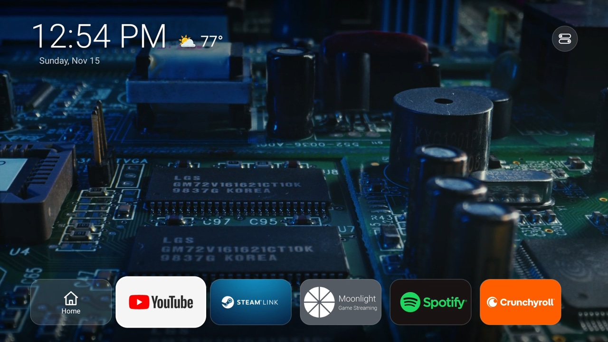
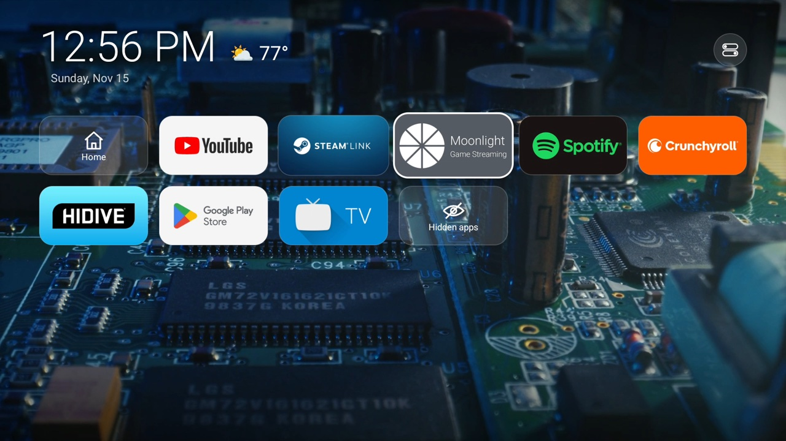
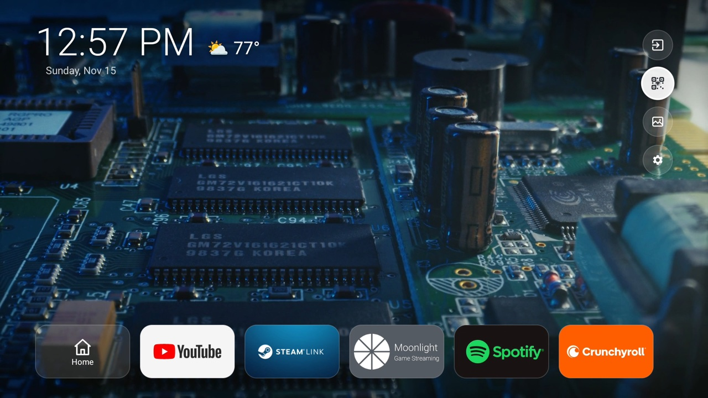
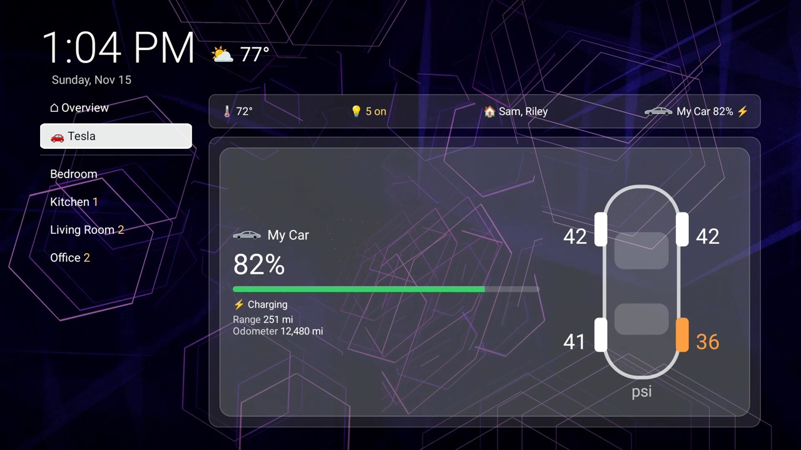
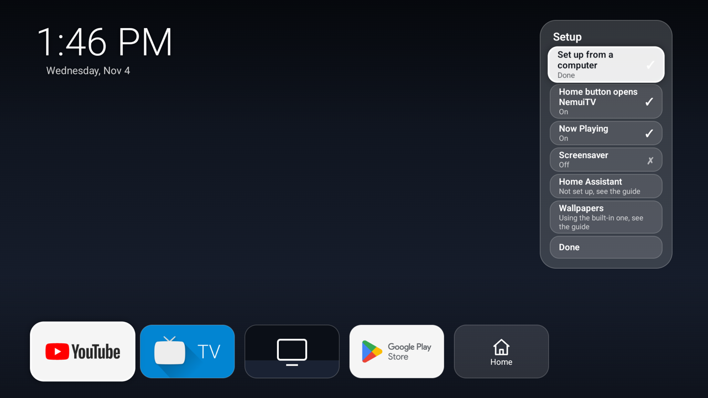

# NemuiTV

A calmer home screen for Google TV. Video wallpapers, a favorites row, a Control Center, and a screensaver with a big clock.
Optional extras: Home Assistant (lights, cameras, doorbell, Tesla) and a Spotify heart button.

NemuiTV is free and open source. It is offered as-is: there is no support promise, and it is not on the Play Store.
You install it from your computer over Wi-Fi.

## What you get

- A home screen with your favorite apps in a row and the rest in a tray (press Down from the row).
- Looping video wallpapers (you add your own; a dark gradient shows until you do).
- A Control Center (hold the Home button) with Wi-Fi QR, next wallpaper and settings.
- A screensaver with a clock, plus a Now Playing banner for music apps.
- Optional: Home Assistant rooms, scenes, cameras, doorbell pop-up, appliance alerts and Tesla (battery, tires, temperatures). See [docs/home-assistant.md](docs/home-assistant.md).
- Optional: a Spotify heart button to like the playing song. See [docs/spotify.md](docs/spotify.md).

| Tray | Control Center |
|---|---|
|  |  |
| **Home Assistant** | **Setup page** |
|  |  |

## Supported devices

- **Google TV Streamer:** the tested, official target.
- **Chromecast with Google TV:** should work, with caveats. It is slower, and its wallpapers must be smaller (see [docs/wallpapers.md](docs/wallpapers.md)).
- **TVs with Google TV built in:** setup supports them through ADB debugging. Tested on a Sony BRAVIA (Android TV 12). Other brands should work the same way; please open an issue if yours doesn't.
- Other Android TV or Google TV boxes: untested.

You need a Mac, Windows or Linux computer on the same Wi-Fi network as the TV.

## Quick start

NemuiTV never turns off Google's home screen. It takes over the remote's Home button instead: tap Home for NemuiTV, hold Home for the Control Center. Google's home stays installed, and undo gives the Home button back to it.

1. Download `NemuiTV-setup-1.2.1.zip` from the [latest release](https://github.com/NemuiAlek/nemuitv/releases/latest) and unzip it. It holds the APK, the scripts and `config.example.json`.
   - On Windows the simple path is the browser: open the Releases page, download the zip and unzip it (right-click, Extract All). The GitHub command-line tool `gh` is optional, and `winget install --id GitHub.cli` needs an administrator prompt, so you don't need it.
2. Open a terminal in the unzipped folder.
   - Mac or Linux: `bash scripts/setup.sh`
   - Windows (PowerShell): `powershell -ExecutionPolicy Bypass -File scripts\setup.ps1`
3. Follow the prompts. The script finds or downloads Google's `adb` tool (it asks first), asks which debugging option your TV has and connects to it, installs the app, and grants it its permissions. One of them lets NemuiTV install its own updates, so you can update from the TV later. Android still asks you before every install.
   - Setup asks which option your TV's Developer options has: "Wireless debugging" (Google TV Streamer, Chromecast with Google TV), which uses a pairing code, or "ADB debugging" / "Network debugging" (TVs with Google TV built in), which only needs the TV's IP address.
4. The script then turns on the Home-button takeover and Now Playing, and opens NemuiTV on the TV.
5. On the TV, open the Setup page (hold Home, then Launcher settings, then Setup). The first three rows should say Done or On. Turn Screensaver on here if you want NemuiTV as your screensaver. You can turn Wireless debugging or ADB debugging off now.

Optional: check the download first. `NemuiTV-1.2.1.apk.sha256` on the release page holds the expected hash. On Mac, `shasum -a 256 NemuiTV-1.2.1.apk` should print the same value.

Stuck on a step? [docs/manual-setup.md](docs/manual-setup.md) lists every `adb` command the script runs.

If Windows blocks the script, use the `-ExecutionPolicy Bypass` form above, or run `Unblock-File scripts\*.ps1` once and then `scripts\setup.ps1`.

If Home opens Google's home again after a Google TV update, run the setup script again. It is safe to repeat.

## Undo

Run the undo script from the same folder:

- Mac or Linux: `bash scripts/undo.sh`
- Windows: `powershell -ExecutionPolicy Bypass -File scripts\undo.ps1`

It removes only NemuiTV's own entries from Android's accessibility and notification-listener lists. The Home button goes back to Google's home. If NemuiTV is your screensaver, it restores Google's Backdrop screensaver and the stock timers, and revokes the permissions. It then asks whether to uninstall the app too.

## Optional extras

- **Wallpapers:** [docs/wallpapers.md](docs/wallpapers.md). Format, free sources, the `fix-wallpapers` converter, and `push-wallpapers`.
- **Settings file:** [docs/configuration.md](docs/configuration.md). Every field of `config.json`, sent with `push-config`.
- **Home Assistant:** [docs/home-assistant.md](docs/home-assistant.md).
- **Spotify heart:** [docs/spotify.md](docs/spotify.md).
- **Using an AI agent?** Give it [docs/ai-setup.md](docs/ai-setup.md). It lists the exact names NemuiTV reads from Home Assistant, with a check for each step.

## License and name

The code is [MIT licensed](LICENSE), copyright 2026 Nemui Games LLC.

The NemuiTV name and Nemui Games logo are not covered by the license. Forks must use a different name and icon.

Release builds are signed with a private key. If that key were lost, future builds could not update an existing install in place. You would have to uninstall and reinstall.
